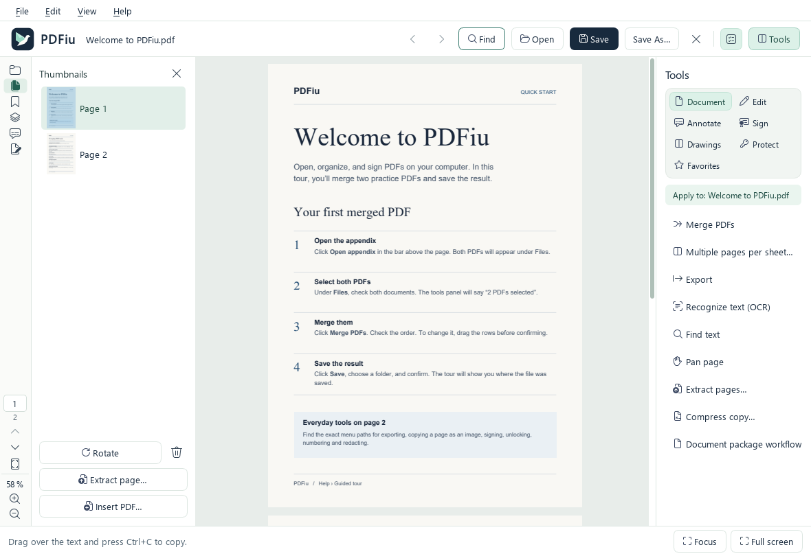

# PDFiu

[Español](README.md) · **English**

An open-source PDF reader and editor created by **mfcb89**, built as a lightweight, 100% local alternative to heavy proprietary PDF readers. Open, organize, edit, sign, measure drawings, and convert documents from a desktop app with no account, no cloud, and no telemetry. The interface and guided tour are available in Spanish and English.



## Why PDFiu

- **100% local and private:** your PDFs stay on your computer. PDFiu requires no account and makes no network requests unless you manually check for updates or enable the opt-in startup update check.
- **Complete desktop toolkit:** includes features commonly locked behind paid subscriptions (merging and organizing pages, editing text, filling forms, English/Spanish OCR, digital signatures, redaction, drawing comparison/measurement, and exporting to Word, Excel, and Markdown).
- **Sustainable open source:** the full source code is public under the MIT License and can be built and run for free. The paid official Windows installer funds ongoing development, code signing, and updates.

## What you can do

| Area | Features |
| --- | --- |
| Read | Continuous scrolling, zoom, full screen, thumbnails, bookmarks, layers, and search with context, optional accent matching, and operators. |
| Organize pages and batches | Keep several PDFs in a workspace, merge with an index, extract or reorder pages, insert them by dragging, rotate pages, and arrange multiple pages per sheet. |
| Edit and review | Edit supported text, fill AcroForm fields, and add comments, highlights, shapes, headers, footers, and page numbers. |
| Sign and protect | Add visible certificate signatures to pages or batches, inspect signature details, protect copies, and redact areas. |
| Work with drawings | Compare side by side, overlay drawings, or highlight changes. Calibrate a known distance or drawing scale and measure length, perimeter, and area. |
| OCR and export | Recognize English and Spanish on one page or throughout a PDF. Export to Word, Excel, CSV, Markdown with preview, TXT, or PNG. Copy a page as an image. |
| Print and prepare copies | Preview print output, print at actual size, fit, tile, or make a booklet. Estimate compression and export PDF/A with external tools. |

[User guide](USER_GUIDE.en.md) · [Build guide](packaging/LEEME.en.md) · [Changelog](CHANGELOG.md)

## Get PDFiu

### Official installer (Windows x64)

The ready-to-use official installer (no Python setup required) will be distributed through the official download page to fund ongoing development, code signing, and the update channel.

### Run for free from source

The public repository contains the complete source code. The installer recipe targets Windows x64; build the macOS package on macOS and validate it on the target architecture.

1. Open a PowerShell terminal with Git and 64-bit Python 3.12.
2. Clone the repository and run these commands:

```powershell
git clone https://github.com/mfcb89/pdfiu.git
cd pdfiu
py -3.12 -m venv .venv
.\.venv\Scripts\python.exe -m pip install -r requirements.txt
.\.venv\Scripts\python.exe pdfiu.py
```

To enable English and Spanish OCR, place `spa.traineddata` and `eng.traineddata` in `runtime/tessdata`. [Set up OCR models](USER_GUIDE.en.md#set-up-ocr-models)

## Compatibility

- Form editing uses AcroForm. Forms that rely entirely on dynamic XFA need an XFA-compatible reader.
- Basic signing uses P12/PFX files and, on Windows, supported certificates from the system store. The signatures panel displays available certificate details. Chain trust, timestamping, and long-term validation are outside this version.
- Word export reconstructs the layout approximately. Complex drawings, columns, and scans may need manual adjustment.
- PDF/A needs Ghostscript, veraPDF, and Java. Redaction rasterizes marked pages and offers OCR to recover visible text. [Usage details](USER_GUIDE.en.md)

## Contribute, security, and license

- Open an [issue](https://github.com/mfcb89/pdfiu/issues) or submit a pull request (Spanish and English are welcome). [Contribution guide](CONTRIBUTING.md)
- To report a security vulnerability privately, see [SECURITY.md](SECURITY.md#english).
- PDFiu's original source code is available under the [MIT License](LICENSE). You can use, modify, and redistribute the code, including commercially, if you keep the copyright and license notice.
- The **PDFiu** name and logos in `assets/brand/` are reserved and are not covered by the MIT License. See the [brand policy](TRADEMARKS.md#pdfiu-trademark-and-brand-policy).
- Third-party libraries and assets have their own terms (including Qt and PySide6 under LGPLv3). Review the [third-party notices](THIRD_PARTY_NOTICES.md#english) before redistributing a binary.
