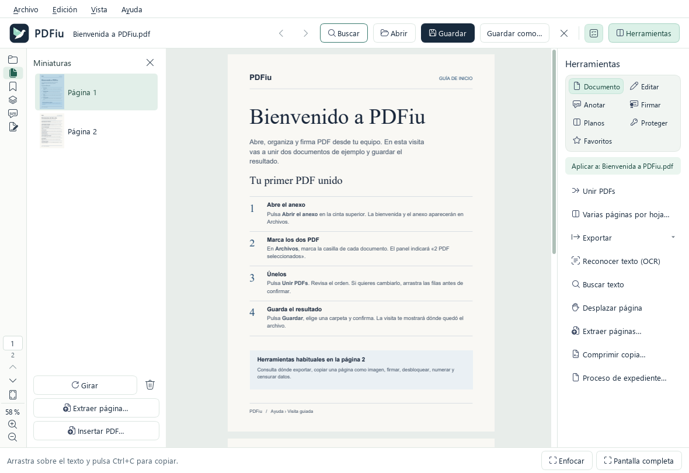

# PDFiu

**Español** · [English](README.en.md)


Lector y editor de PDF de código abierto creado por **mfcb89**, pensado como alternativa ligera y 100% local a los lectores propietarios pesados. Abre, organiza, edita, firma, mide planos y convierte documentos desde una aplicación de escritorio sin cuentas, sin nube y sin telemetría. La interfaz (con tema claro y oscuro) y la visita guiada están disponibles en español e inglés.



## Por qué PDFiu

- **100% local y privado:** tus PDF se procesan únicamente en tu equipo. PDFiu no requiere cuenta ni realiza conexiones de red salvo que consultes actualizaciones manualmente o actives la comprobación opcional al iniciar.
- **Todo en una sola app ligera:** incluye funciones que suelen exigir licencias o suscripciones externas (unir y organizar páginas, editar texto, rellenar formularios, OCR en español e inglés, firma digital, censura, medición/comparación de planos y exportación a Word, Excel y Markdown).
- **Código abierto sostenible:** el código fuente es público bajo licencia MIT y puedes compilarlo gratis en tu equipo. El instalador oficial de pago para Windows financia el desarrollo, la firma de código y las actualizaciones.

## Qué puedes hacer

| Área | Funciones |
| --- | --- |
| **Lectura y navegación** | Pestañas desmontables en varias ventanas, vista continua o **doble página (`Ctrl+2`)**, tema claro y oscuro, pantalla completa, miniaturas, filtro de marcadores, búsqueda rápida (`Ctrl+F`) con tildes/operadores y paleta de comandos (`Ctrl+K`). |
| **Organizar, unir y dividir** | **Cuadrícula visual de páginas** para reordenar arrastrando, girar o eliminar; unir varios PDF con índice automático, **dividir PDF** por rangos o cada N hojas, extraer páginas, varias páginas por hoja y mesa de trabajo en lote. |
| **Comprimir PDF** | **3 niveles rápidos** (*Baja*, *Recomendada* y *Extrema*) más **Opciones avanzadas**: compresión de imágenes `RGB`, `ICCBased`, `CMYK`, `JPEG2000` y transparencias (`SMask`), paso a escala de grises, limpieza de datos privados/miniaturas/metadatos, **estimación previa** y **comparación visual al 100 %** antes de guardar. |
| **Editar y anotar** | Editar texto compatible, añadir texto nuevo, rellenar y fijar formularios **AcroForm**, encabezados, pies y numeración de páginas; resaltados, subrayados, notas, formas y panel de anotaciones con filtros. |
| **Firmar con certificado** | Firma digital **PAdES (RSA y ECDSA)** con certificados del almacén de Windows o archivos `.pfx`/`.p12`, recuadro visible, **firma en lote** y explorador de firmas con verificación de integridad. |
| **Proteger y privacidad** | **Desbloquear PDF**, cifrar copias con contraseña **AES-256**, **censura irreversible** (borra el contenido real con OCR opcional) y **preparar copia para compartir** sin metadatos. |
| **OCR y exportación** | **OCR local** en español e inglés (Tesseract) en una página o en todo el documento. Exportar a **Word (`.docx`)**, **Excel (`.xlsx`)**, **CSV**, **Markdown (`.md`)** con vista previa, **TXT**, **PNG**, **PDF/A** y **copiar página como imagen** (`Ctrl+Shift+C`). |
| **Planos e impresión** | Comparar revisiones en paralelo, superpuestas o resaltando diferencias; calibrar escalas `1:N` y medir longitudes, perímetros y superficies. Impresión con vista previa, tamaño real, mosaico para planos y folleto. |

[Manual de usuario](LEEME.md) · [Guía de compilación](packaging/LEEME.md) · [Política de privacidad](PRIVACY.md) · [Historial de cambios](CHANGELOG.md)

## Obtener PDFiu

### Tienda oficial (Microsoft Store · Windows x64)

La versión oficial lista para usar en Windows 10/11 (sin instalar Python ni dependencias, con modelos de OCR incluidos, pago único y **15 días de prueba gratuita**) está disponible en [Microsoft Store](https://apps.microsoft.com/detail/9NK06R3SRRW3) y financia el desarrollo continuo y las actualizaciones.

### Ejecutar gratis desde el código fuente

El repositorio público contiene el código fuente completo. La receta de instalador está pensada para Windows x64; el empaquetado de macOS se realiza en macOS y requiere validación en la arquitectura de destino.

1. Abre una terminal PowerShell con Git y Python 3.12 de 64 bits.
2. Clona el repositorio y ejecuta estos comandos:

```powershell
git clone https://github.com/mfcb89/pdfiu.git
cd pdfiu
py -3.12 -m venv .venv
.\.venv\Scripts\python.exe -m pip install -r requirements.txt
.\.venv\Scripts\python.exe pdfiu.py
```

Para habilitar el OCR en español e inglés, coloca `spa.traineddata` y `eng.traineddata` en `runtime/tessdata`. [Preparar los modelos de OCR](LEEME.md#preparar-los-modelos-de-ocr)

## Compatibilidad

- La edición de formularios usa AcroForm. Los formularios que dependen únicamente de XFA dinámico requieren un lector compatible con XFA.
- La firma básica admite archivos P12/PFX y, en Windows, certificados compatibles del almacén del sistema. El panel de firmas muestra los datos disponibles del certificado. La confianza de la cadena, el sellado de tiempo y la validación de larga duración quedan fuera de esta versión.
- Word reconstruye el diseño de forma aproximada. Los planos complejos, las columnas y las páginas escaneadas pueden requerir ajustes.
- PDF/A requiere Ghostscript, veraPDF y Java. La censura rasteriza las páginas marcadas y ofrece OCR para recuperar el texto visible. [Detalles de uso](LEEME.md)

## Contribuir, seguridad y licencia

- Abre una [incidencia](https://github.com/mfcb89/pdfiu/issues) o envía una propuesta de cambios (en español o inglés). [Guía de contribución](CONTRIBUTING.md)
- Para informar de un problema de seguridad en privado, consulta [SECURITY.md](SECURITY.md).
- El código fuente original de PDFiu se distribuye bajo la [licencia MIT](LICENSE). Puedes usar, modificar y redistribuir el código, incluso comercialmente, conservando el aviso de copyright y la licencia.
- El nombre **PDFiu** y los logotipos en `assets/brand/` están reservados y no se incluyen en la licencia MIT. Consulta la [política de marca](TRADEMARKS.md).
- Las bibliotecas y recursos de terceros mantienen sus propios términos (incluidos Qt y PySide6 bajo LGPLv3). Consulta los [avisos de terceros](THIRD_PARTY_NOTICES.md) antes de redistribuir un binario.
